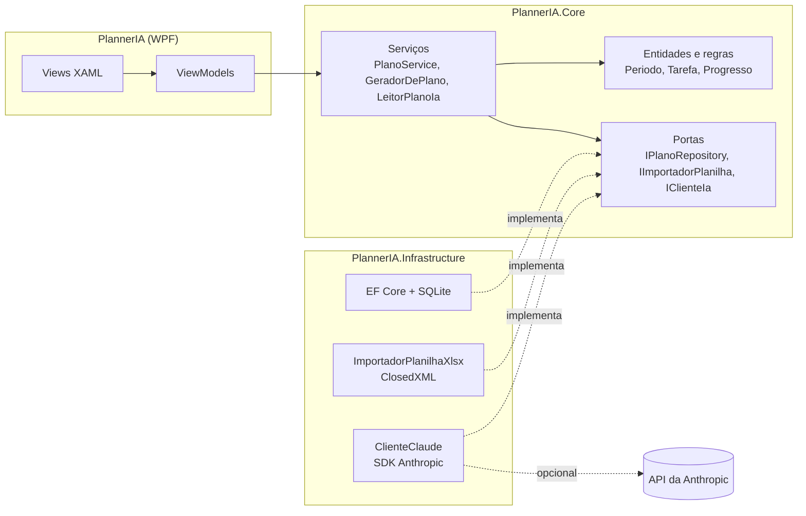
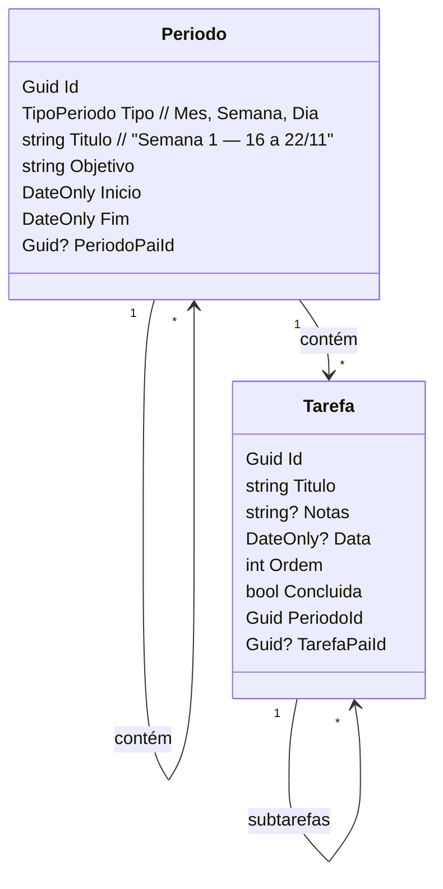
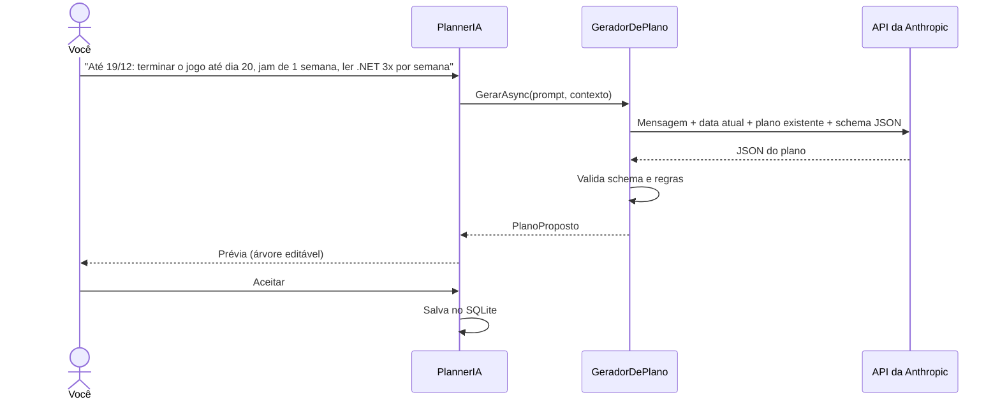

# PlannerIA

Aplicativo desktop em WPF/.NET para planejar a rotina por mês, semana e dia, com tarefas principais, subtarefas e checkbox.

A ideia nasceu de uma planilha de objetivos semanais (uma aba por semana, um objetivo resumido e tarefas com subtarefas). O app substitui a planilha, importa a planilha existente e pode gerar planos com IA.

**Princípios:**

- **Nada vai para servidor.** Os dados ficam só em um banco SQLite no seu computador.
- **Não depende de internet.** Todas as funções (planejar, marcar, importar, ver o progresso) funcionam offline.
- **IA opcional.** A geração de planos com o Claude liga sozinha quando existe um provedor (o **Claude CLI** com login na sua assinatura, ou uma **chave da API**) **e** internet. Se faltar qualquer um, o app funciona normalmente, só sem essa função (os botões de IA somem e a barra lateral mostra o motivo).

## Status do projeto

**MVP implementado.** Visões Hoje, Semana, Mês e Visão geral, criação/edição de semanas e tarefas, importação da planilha `.xlsx`, temas claro e escuro e geração de planos com IA (opcional, com prévia editável).

## Tecnologias

| Camada | Tecnologia | Motivo |
| --- | --- | --- |
| UI | WPF (.NET 9) | Desktop nativo no Windows, data binding maduro |
| Padrão de UI | MVVM com CommunityToolkit.Mvvm | Menos código repetido (`[ObservableProperty]`, `[RelayCommand]`) e ViewModels testáveis |
| Persistência | EF Core + SQLite | Banco local em um arquivo, sem servidor |
| Importação | ClosedXML | Lê a planilha `.xlsx` (uma aba por semana) |
| IA (opcional) | Claude Code CLI (`claude -p`, assinatura) ou SDK oficial da Anthropic para C# (`Anthropic`, API) | Geração do plano com saída estruturada (JSON Schema) |
| Testes | xUnit | Regras de domínio, serviço, importador, banco e IA (com cliente falso) |

## Funcionalidades

### MVP

- [x] Criar **períodos**: mês (automático) e semana (com intervalo de datas e objetivo resumido)
- [x] Criar **tarefas principais** e **subtarefas** (um nível) com checkbox, notas e dia
- [x] Progresso automático na tarefa principal ("2 de 3") e visto quando todas as subtarefas estão feitas
- [x] Visões **Hoje** (dia), **Semana** e **Mês** (calendário)
- [x] **Visão geral**: árvore Mês → Semanas → Tarefas com barra de progresso em cada nível
- [x] Importar a planilha `.xlsx` atual (uma aba por semana) com ClosedXML
- [x] Categorias com cor (a mesma tarefa principal, ex.: "Inglês", tem a mesma cor em todas as semanas)
- [x] Tema claro/escuro, atalhos de teclado e animações (transições de página, progresso, checkbox, diálogos)
- [x] **Gerar plano com IA** (opcional): pedido em texto livre → prévia → aceitar, editar ou descartar
- [x] Status da IA na barra lateral e em Configurações (disponível, sem chave, chave recusada, sem internet)

### Depois do MVP

- [ ] Pedir à IA para **reorganizar** a semana a partir do que ficou pendente
- [ ] Rotina fixa por dia da semana (ex.: terça a quinta com trajeto de ônibus, segunda e sexta em casa)
- [ ] Exportar a semana em Markdown

## Arquitetura

Três projetos de código e um de testes. Para um app desse tamanho, isso basta para separar a UI das regras de negócio e da infraestrutura sem burocracia.



| Projeto | Responsabilidade | Depende de |
| --- | --- | --- |
| `PlannerIA.Core` | Entidades, regras (progresso, conclusão), `PlanoService`, geração/validação do plano da IA e interfaces | Nada |
| `PlannerIA.Infrastructure` | EF Core/SQLite, importador da planilha e cliente do Claude | Core |
| `PlannerIA` | Telas WPF, ViewModels, tema, controles animados e injeção de dependência | Core, Infrastructure |
| `PlannerIA.Tests` | Testes de regras, serviço, importador e banco | Core, Infrastructure |

Pastas do app WPF: `Temas/` (cores claro/escuro e estilos), `Controles/` (barra e anel de progresso animados, painel em colunas, transições), `ViewModels/`, `Views/`.

### Modelo de domínio



**Regras:**

1. Uma subtarefa não tem subtarefas (só um nível).
2. Uma tarefa principal **com** subtarefas fica concluída quando todas as subtarefas estão concluídas. Ela não é marcada à mão.
3. Uma tarefa principal **sem** subtarefas é marcada à mão.
4. O progresso de um período é a soma das tarefas folha concluídas sobre o total de tarefas folha.
5. Uma semana pertence a um mês, e um dia pertence a uma semana. A semana pode atravessar dois meses (ex.: 30/11 a 06/12). Nesse caso ela fica no mês em que começa.

## Geração de plano com IA (opcional)

### Dois provedores: Claude CLI (assinatura) ou API (chave)

| Provedor | Como paga | O que precisa |
| --- | --- | --- |
| **Claude CLI** (Claude Code) | Pela sua assinatura do Claude (Pro/Max), dentro do limite de uso dela. Sem cobrança extra | Claude Code instalado e com login na sua conta |
| **API** | Por token, na conta da API (cobrança à parte da assinatura) | Chave em `ANTHROPIC_API_KEY` |

Em **Configurações → Assistente de IA → Como usar a IA** você escolhe **Automático** (padrão: usa o CLI se estiver instalado e logado; senão, a API), **Claude CLI** ou **API (chave)**. A escolha fica em `config.json`.

### Quando fica disponível

| Situação | O que acontece |
| --- | --- |
| Provedor pronto e internet ok | Botão **Gerar com IA** nas telas Hoje e Semana, atalho `Ctrl+G`, ponto verde e nome do provedor na barra lateral |
| CLI não encontrado | "Claude CLI não encontrado". Configurações mostra o comando de instalação, com botão para copiar |
| CLI instalado, sem login | "Claude CLI sem login". Botão **Fazer login no Claude CLI** abre um terminal com o `claude` para você entrar |
| Sem chave (modo API) | "IA desligada". Nada é chamado na rede |
| Chave inválida (modo API) | "Chave da API recusada" |
| Sem internet | "IA sem internet". Volta sozinha quando a rede volta |

A checagem roda ao abrir o app, quando a rede muda e a cada minuto enquanto a IA estiver indisponível (a cada 10 minutos quando disponível), e nunca bloqueia a interface. Nada dela gasta uso ou dinheiro: para o CLI, roda `claude --version` e `claude auth status`; para a API, consulta a lista de modelos.

### Como o Claude CLI é chamado

O app procura o `claude` no PATH (do processo e do usuário), em `%USERPROFILE%\.local\bin` (instalador nativo) e em `%APPDATA%\npm` (instalação via npm), ou usa o caminho em `PLANNERIA_CLAUDE_CLI`. Para gerar, roda:

```bash
claude -p --output-format json --json-schema "<formato do plano>" --system-prompt-file instrucoes.txt --model opus --tools "" --strict-mcp-config --permission-mode dontAsk --no-session-persistence --max-turns 5
```

- O pedido vai pela entrada padrão; o plano volta no campo `structured_output` do JSON.
- `--tools ""`: o Claude não lê nem altera arquivos, só responde. `--no-session-persistence`: a conversa não fica no histórico do Claude Code.
- Roda numa pasta vazia própria (`%LOCALAPPDATA%\PlannerIA\claude-cli`), para não carregar `CLAUDE.md`, hooks ou `.mcp.json` de outra pasta.
- **Não usa `--bare`**: esse modo ignora o login da assinatura e exige uma chave da API.
- **Remove `ANTHROPIC_API_KEY` do ambiente do CLI**: com ela definida, o CLI cobraria pela API em vez de usar a assinatura.
- O modelo padrão é `opus` (troque com `PLANNERIA_MODELO_CLI`, ex.: `sonnet`).

Para instalar o Claude Code no Windows e entrar com a sua conta:

```bash
irm https://claude.ai/install.ps1 | iex
```

Depois, clique em **Fazer login no Claude CLI** em Configurações (ou rode `claude` num terminal) e entre com a sua conta.

> Uso pessoal: usar o seu próprio Claude Code, com a sua conta, no seu computador, não tem problema. Se for distribuir o app para outras pessoas, confira os termos da Anthropic: eles restringem que apps de terceiros usem o login do claude.ai no lugar da API.

No modo API, cada geração consome tokens da sua conta na API (cobrança à parte). Defina um limite de gastos no [Claude Console](https://console.anthropic.com/).

### Fluxo



**O app nunca grava o que a IA devolve sem a sua confirmação.** Na prévia você pode desmarcar semanas, tarefas ou subtarefas, editar títulos e objetivos, ajustar o pedido e gerar de novo, ou descartar tudo. Uma semana proposta com as mesmas datas de uma existente aparece como "acrescenta à semana existente": as tarefas novas entram nela, e uma tarefa principal com o mesmo nome (ex.: "Inglês") recebe as subtarefas novas.

### Contrato JSON

A resposta usa **saída estruturada** (`output_config.format` com JSON Schema estrito), então sempre vem nesse formato:

```json
{
  "resumo": "O que foi proposto, em 1 a 3 frases",
  "semanas": [
    {
      "titulo": "Semana 1 — 16 a 22/11",
      "objetivo": "Terminar o jogo atual antes da jam",
      "inicio": "2026-11-16",
      "fim": "2026-11-22",
      "tarefas": [
        {
          "titulo": "Finalizar o jogo",
          "data": null,
          "notas": null,
          "subtarefas": [
            { "titulo": "Corrigir bugs da fase 2", "data": "2026-11-17", "notas": null },
            { "titulo": "Publicar no itch.io", "data": "2026-11-19", "notas": "build final" }
          ]
        }
      ]
    }
  ]
}
```

O `GeradorDePlano` envia, além do pedido:

- a data de hoje e o fuso (`America/Sao_Paulo`), para a IA calcular as datas certas;
- as semanas já cadastradas (a partir da semana passada) com suas tarefas, para não duplicar;
- as regras do domínio (um nível de subtarefa, datas dentro da semana), em instruções fixas.

O que é enviado à API: o pedido e esse resumo das semanas. Nada é enviado quando você não usa a IA.

Depois da resposta, o `LeitorPlanoIa` valida: datas dentro da semana (a data inválida é removida com aviso), títulos não vazios, intervalo de semana válido, um único nível de subtarefas. Os avisos aparecem na prévia. Se nada sobrar, ou se a API falhar (sem conexão, limite de uso, chave recusada), o diálogo mostra o erro e deixa tentar de novo. Nada parcial é salvo.

Detalhes da chamada pela API: modelo `claude-opus-5-5` (troque com `PLANNERIA_MODELO`), esforço `medium` e *fallback* no servidor (`fallbacks: "default"`, beta `server-side-fallback-2026-07-01`) para o caso de o modelo recusar o pedido por política.

### Modo demonstração

Com `PLANNERIA_IA_DEMO=1`, o app simula a IA com um plano fixo, sem internet e sem custo. Serve para testar a tela de geração e a prévia.

## Pré-requisitos

- Windows 10 ou 11 (os cantos arredondados da janela aparecem só no 11)
- .NET 9 SDK
- Visual Studio 2022/2026 com a carga "Desenvolvimento para desktop com .NET" (ou Rider)

## Como executar

```bash
dotnet build
dotnet test
dotnet run --project PlannerIA
```

Na primeira abertura o plano está vazio: use **Importar planilha** (ou Configurações → Importar) e escolha `Objetivos-Semanais-Nov-Dez.xlsx`, ou crie uma semana do zero. Para importar direto pela linha de comando:

```bash
dotnet run --project PlannerIA -- --importar "Objetivos-Semanais-Nov-Dez.xlsx"
```

### Atalhos

| Atalho | Ação |
| --- | --- |
| `Ctrl+1` … `Ctrl+5` | Hoje, Semana, Mês, Visão geral, Configurações |
| `Ctrl+N` | Nova tarefa (na semana aberta ou no dia exibido) |
| `Ctrl+Shift+N` | Nova semana |
| `Ctrl+G` | Gerar plano com IA (quando disponível) |
| `Ctrl+T` | Alterna tema claro/escuro |
| `Enter` / `Esc` | Confirma / cancela um diálogo |

### Formato da planilha

Uma aba por semana. Abas sem intervalo de datas no título (ex.: "Resumo") são ignoradas.

- `A1`: título com o intervalo, ex.: `Semana 1 — 16 a 22/11` ou `Semana 3 — 30/11 a 06/12`
- `A2`: `Objetivo: ...`
- Uma linha de cabeçalho com `Tipo`, `Tarefa`, `Dia`, `Feito`, `Notas`
- `Tipo` = `Principal` ou `Sub`; `Dia` como `Seg 16` vira a data. Textos como `Ter–Qui` vão para as notas; `Feito` = `✔` marca a subtarefa
- O ano vem do título da aba "Resumo" (ex.: `Objetivos Nov–Dez 2026`) ou, se não houver, do ano atual
- Semanas com as mesmas datas de uma já cadastrada são ignoradas, então importar de novo não duplica nada

## Configuração

| Configuração | Onde fica | Observação |
| --- | --- | --- |
| Banco | `%LOCALAPPDATA%\PlannerIA\planner.db` | Criado na primeira execução (`EnsureCreated`) |
| Tema e provedor da IA | `%LOCALAPPDATA%\PlannerIA\config.json` | Escolhidos em Configurações (`Tema`, `ModoIa`: `Automatico`, `ClaudeCli` ou `Api`) |
| Caminho do Claude CLI | Variável de ambiente `PLANNERIA_CLAUDE_CLI` | Opcional. Só se o `claude` estiver fora do PATH e das pastas padrão |
| Modelo do Claude CLI | Variável de ambiente `PLANNERIA_MODELO_CLI` | Opcional. Padrão: `opus` |
| Chave da API (opcional) | Variável de ambiente do usuário `ANTHROPIC_API_KEY` (`HKCU\Environment`) | Liga a IA. Salva pela tela de Configurações ou à mão. Nunca fica em arquivo do app nem vai para o repositório |
| Modelo da IA | Variável de ambiente `PLANNERIA_MODELO` | Opcional. Padrão: `claude-opus-5-5` |
| Modo demonstração da IA | Variável de ambiente `PLANNERIA_IA_DEMO=1` | Simula a IA, sem rede |
| Pasta de dados alternativa | Variável de ambiente `PLANNERIA_DATA_DIR` | Útil para testar sem mexer nos dados reais |

### Salvar a chave da API pelo app

Em **Configurações → Assistente de IA → Chave da API**, cole a chave e clique em **Salvar chave**. O app:

1. roda o PowerShell com um comando fixo que grava a variável do usuário:
   `New-ItemProperty -Path 'HKCU:\Environment' -Name 'ANTHROPIC_API_KEY' -Value $v -PropertyType String -Force`;
2. passa a chave ao PowerShell por uma variável de ambiente do processo filho (`PLANNERIA_NOVA_CHAVE`), **nunca pela linha de comando**, para ela não aparecer na lista de processos nem em logs de comandos;
3. avisa o Windows da mudança sem esperar resposta (`WM_SETTINGCHANGE` via `SendNotifyMessage`), para que programas abertos depois também enxerguem a chave;
4. passa a usar a chave na hora e verifica se a IA ficou disponível.

A tela mostra só o começo e o fim da chave salva (`sk-ant-…a1b2`). **Remover** apaga a variável (com confirmação). Se a chave estiver definida fora do app (no sistema ou no processo), a tela avisa e o botão Remover não aparece.

> O comando mais óbvio, `[Environment]::SetEnvironmentVariable(..., 'User')`, não é usado porque ele espera cada janela aberta responder ao aviso de mudança e chegou a levar mais de 80 segundos na máquina de desenvolvimento. Gravar em `HKCU:\Environment` e avisar sem esperar tem o mesmo efeito e é imediato.

Também dá para definir à mão (vale para novos processos; depois clique em **Verificar de novo**):

```bash
setx ANTHROPIC_API_KEY "sua-chave"
```

> O banco é criado com `EnsureCreated`. Quando o esquema precisar mudar com dados reais já salvos, o próximo passo é trocar para migrations do EF Core.

## Testes

`dotnet test` roda 54 testes, sem rede e sem gastar uso:

- **Regras de domínio:** a principal conclui sozinha quando todas as subtarefas terminam, desmarcar reabre, principal com subtarefas não é marcada à mão, só um nível de subtarefa.
- **Progresso:** por semana e por mês (só tarefas folha).
- **PlanoService:** semana que atravessa dois meses fica no mês em que começa, título automático, semana duplicada, data fora da semana, reordenação, remoção do mês vazio (com um repositório falso).
- **Importador:** lê semanas, datas, feitos e notas de uma planilha gerada no teste; se `Objetivos-Semanais-Nov-Dez.xlsx` estiver na raiz, também importa a planilha real.
- **SQLite:** importa, salva, reabre e confere; remover a principal remove as subtarefas.
- **IA (com cliente falso, nunca chama a API):** leitura do JSON, data fora da semana removida, título vazio e subtarefa aninhada ignorados, respostas inválidas viram erro amigável; o pedido leva a data de hoje, as semanas existentes e o texto do usuário; gerar não salva nada; aviso de semana sobreposta; aplicar cria semanas novas e acrescenta nas existentes.
- **Claude CLI:** escolha do provedor (automático prefere o CLI, cai para a API, avisa quando não há nenhum ou falta login; modo CLI nunca usa a API); argumentos sem `--bare` e sem ferramentas; leitura do `structured_output`, do `auth status` e dos erros (sem login, limite de uso). Um teste de ponta a ponta roda um `claude` falso (`.cmd`) e confere versão, login, pedido pela entrada padrão e que a `ANTHROPIC_API_KEY` não chega ao CLI.
- **Claude CLI de verdade (opcional):** com `PLANNERIA_TESTE_CLI_REAL=1`, gera um plano pequeno pelo CLI instalado. Consome uso da assinatura, por isso fica desligado por padrão.
- **Chave da API (PowerShell de verdade):** salva, lê e remove uma variável **temporária** do usuário (nunca a `ANTHROPIC_API_KEY`), confere que caracteres especiais (`' " $ ; | &`) chegam intactos e que chave vazia ou com espaços é recusada antes de rodar o PowerShell. A variável de teste é apagada no fim.

## Decisões de arquitetura

| Decisão | Alternativa considerada | Motivo |
| --- | --- | --- |
| SQLite local | Arquivo JSON | Consultas por data e hierarquia ficam simples com EF Core, e já prepara uma sincronização futura |
| Um nível de subtarefa | Árvore infinita | Espelha a planilha. Mais níveis complicam a UI e o progresso sem ganho real |
| Prévia obrigatória antes de salvar | Gravar direto | A IA pode errar datas ou inventar tarefas. A decisão final é sua |
| Saída estruturada (JSON Schema) | *Tool use* forçado / JSON pedido no prompt | Resposta sempre no formato certo; o `tool_choice` forçado não é aceito pelo Claude Opus 5.5 |
| Claude CLI como provedor preferido no modo automático | Só a API | Usa a assinatura que você já paga; a API fica como alternativa |
| Chave em variável de ambiente do usuário, gravada pelo PowerShell | Arquivo de configuração do app (com DPAPI) | Um lugar só para a chave, que o SDK e outros programas também leem; o app não guarda segredo em arquivo próprio |
| 3 projetos + testes | Clean Architecture completa (4 ou 5 camadas) | Complexidade proporcional ao tamanho do app |

## Melhorias futuras

- Edição em linha (renomear uma tarefa direto no cartão) e arrastar para reordenar
- Lembretes com notificação do Windows
- Sincronizar com um calendário (Outlook ou Google)
- Versão em inglês do README e da UI (o app pode entrar no portfólio .NET)
- GitHub Actions com `dotnet build` e `dotnet test` (runner `windows-latest`, por causa do WPF)

## Contribuição

Projeto pessoal. Quando a solução existir: `dotnet build` e `dotnet test` precisam passar antes de qualquer commit na `main`. Use mensagens no formato Conventional Commits (`feat:`, `fix:`, `docs:`).

## Licença

A definir.
