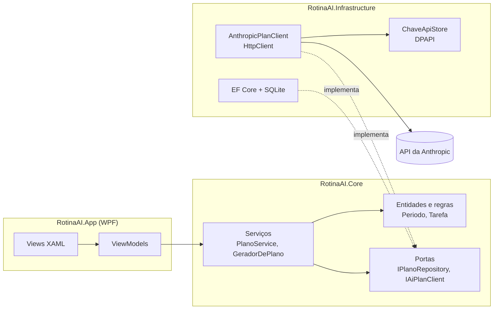
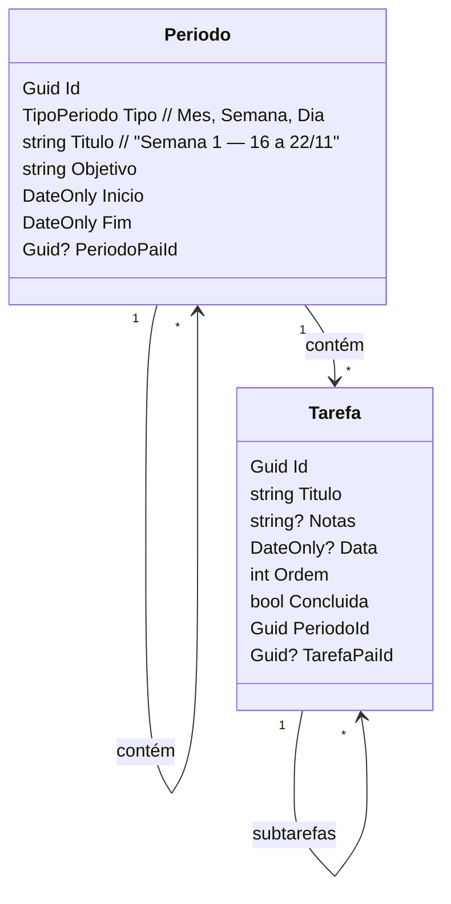
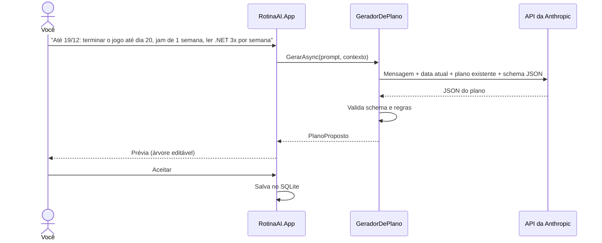

# RotinaAI (nome provisório)

Aplicativo desktop em WPF/.NET para planejar a rotina por mês, semana e dia, com tarefas principais, subtarefas e checkbox. Você descreve o que quer em linguagem natural, a IA (Claude, via API da Anthropic) devolve um plano estruturado e o app mostra uma prévia antes de salvar.

A ideia nasceu de uma planilha de objetivos semanais (uma aba por semana, um objetivo resumido e tarefas com subtarefas). O app substitui a planilha e acrescenta a geração de planos por IA.

## Status do projeto

**Em planejamento.** Nada foi implementado ainda. Este README é a especificação inicial do MVP. As seções de execução e testes descrevem o que se pretende fazer e serão atualizadas com comandos reais quando a solução existir.

## Tecnologias (planejadas)

| Camada | Tecnologia | Motivo |
| --- | --- | --- |
| UI | WPF (.NET 10) | Desktop nativo no Windows, data binding maduro |
| Padrão de UI | MVVM com CommunityToolkit.Mvvm | Menos código repetido (`[ObservableProperty]`, `[RelayCommand]`) e ViewModels testáveis |
| Persistência | EF Core + SQLite | Banco local em um arquivo, sem servidor |
| IA | API da Anthropic (Messages API) via `HttpClient` ou SDK oficial para C# | Geração do plano em JSON com schema fixo |
| Segurança da chave | DPAPI (`System.Security.Cryptography.ProtectedData`) | A chave fica criptografada para o usuário do Windows |
| Testes | xUnit + Moq (ou NSubstitute) | Mesmo padrão já usado no Rastreador de Preços |

## Funcionalidades

### MVP

- [ ] Criar **períodos**: mês, semana (com intervalo de datas e objetivo resumido) e dia
- [ ] Criar **tarefas principais** e **subtarefas** (um nível) com checkbox
- [ ] Progresso automático na tarefa principal ("2 de 3") e visto quando todas as subtarefas estão feitas
- [ ] Visões **Dia**, **Semana** e **Mês**
- [ ] **Visão geral**: árvore Mês → Semanas → Tarefas com barra de progresso em cada nível
- [ ] **Gerar plano com IA**: prompt em texto livre → prévia → aceitar, editar ou descartar
- [ ] Tela de configurações para salvar a chave da API

### Depois do MVP

- [ ] Importar a planilha `.xlsx` atual (uma aba por semana) com ClosedXML
- [ ] Pedir à IA para **reorganizar** a semana a partir do que ficou pendente
- [ ] Categorias com cor (ex.: Jogos, .NET, Inglês, Carreira)
- [ ] Rotina fixa por dia da semana (ex.: terça a quinta com trajeto de ônibus, segunda e sexta em casa)
- [ ] Exportar a semana em Markdown

## Arquitetura

Três projetos de código e um de testes. Para um app desse tamanho, isso basta para separar a UI das regras de negócio e da infraestrutura sem burocracia.



| Projeto | Responsabilidade | Depende de |
| --- | --- | --- |
| `RotinaAI.Core` | Entidades, regras (progresso, conclusão), serviços e interfaces | Nada |
| `RotinaAI.Infrastructure` | EF Core/SQLite, cliente da API, armazenamento da chave | Core |
| `RotinaAI.App` | Telas WPF, ViewModels e injeção de dependência (`Microsoft.Extensions.Hosting`) | Core, Infrastructure |
| `RotinaAI.Tests` | Testes de regras, serviços e parser de JSON | Core, Infrastructure |

### Modelo de domínio



**Regras:**

1. Uma subtarefa não tem subtarefas (só um nível).
2. Uma tarefa principal **com** subtarefas fica concluída quando todas as subtarefas estão concluídas. Ela não é marcada à mão.
3. Uma tarefa principal **sem** subtarefas é marcada à mão.
4. O progresso de um período é a soma das tarefas folha concluídas sobre o total de tarefas folha.
5. Uma semana pertence a um mês, e um dia pertence a uma semana. A semana pode atravessar dois meses (ex.: 30/11 a 06/12). Nesse caso ela fica no mês em que começa.

## Geração de plano com IA

### Fluxo



**O app nunca grava o que a IA devolve sem a sua confirmação.** A prévia permite editar, remover itens ou descartar tudo.

### Contrato JSON

Para a resposta sair sempre no mesmo formato, a ideia é usar *tool use* com `input_schema` (ou o recurso de saída estruturada da API, se estiver disponível no momento da implementação). Isso é mais confiável do que pedir JSON só no texto do prompt.

```json
{
  "periodos": [
    {
      "tipo": "Semana",
      "titulo": "Semana 1 — 16 a 22/11",
      "objetivo": "Terminar o jogo atual antes da jam",
      "inicio": "2026-11-16",
      "fim": "2026-11-22",
      "tarefas": [
        {
          "titulo": "Finalizar o jogo",
          "subtarefas": [
            { "titulo": "Corrigir bugs da fase 2", "data": "2026-11-17" },
            { "titulo": "Publicar no itch.io", "data": "2026-11-19" }
          ]
        }
      ]
    }
  ]
}
```

O `GeradorDePlano` envia junto com o prompt:

- a data de hoje e o fuso (`America/Sao_Paulo`), para a IA calcular as datas certas;
- os períodos que já existem no intervalo, para não duplicar semanas;
- as regras do domínio (um nível de subtarefa, datas dentro do período).

Depois da resposta, ele valida: datas dentro do período, nada além de um nível de subtarefas e títulos não vazios. Se o JSON vier inválido, o app mostra o erro e oferece tentar de novo. Ele não salva nada parcial.

## Pré-requisitos

- Windows 10 ou 11
- .NET 10 SDK
- Visual Studio 2022/2026 com a carga "Desenvolvimento para desktop com .NET" (ou Rider)
- Uma chave da API da Anthropic, criada no [Claude Console](https://console.anthropic.com/)

> A API é cobrada à parte da assinatura do app Claude. Cada geração de plano consome tokens. Use um modelo menor (família Haiku) para testes e defina um limite de gastos no Console.

## Como executar

Ainda não há solução criada. A ideia é criar a estrutura assim (os comandos são ilustrativos e serão revisados quando o projeto existir):

```bash
dotnet new sln -n RotinaAI
dotnet new classlib -n RotinaAI.Core -o src/RotinaAI.Core
dotnet new classlib -n RotinaAI.Infrastructure -o src/RotinaAI.Infrastructure
dotnet new wpf -n RotinaAI.App -o src/RotinaAI.App
dotnet new xunit -n RotinaAI.Tests -o tests/RotinaAI.Tests
dotnet sln add src/**/*.csproj tests/**/*.csproj

dotnet build
dotnet test
dotnet run --project src/RotinaAI.App
```

## Configuração

| Configuração | Onde fica | Observação |
| --- | --- | --- |
| Chave da API | `%APPDATA%\RotinaAI\apikey.bin`, criptografada com DPAPI (`DataProtectionScope.CurrentUser`) | Informada na tela de configurações. Nunca vai para o repositório |
| Chave em desenvolvimento | Variável de ambiente `ANTHROPIC_API_KEY` | Opcional. Tem prioridade sobre o arquivo |
| Modelo | `appsettings.json` → `Ai:Model` | Ex.: `<nome-do-modelo>` (consultar a lista atual na documentação da Anthropic) |
| Banco | `%LOCALAPPDATA%\RotinaAI\rotina.db` | Criado pela migration inicial |

Coloque `apikey.bin`, `*.db` e `appsettings.Development.json` no `.gitignore`.

## Testes

Cenários planejados:

- **Regras de domínio:** a tarefa principal conclui sozinha quando todas as subtarefas terminam, e desmarcar uma subtarefa reabre a principal.
- **Progresso:** cálculo por semana e por mês, inclusive com semana que atravessa dois meses.
- **Parser da IA:** JSON válido, JSON com subtarefa aninhada demais, datas fora do período e campos ausentes.
- **GeradorDePlano:** usa um `IAiPlanClient` falso (Moq). Os testes não chamam a API real.
- **Chave:** a chave salva e lida pelo `ChaveApiStore` volta igual. O arquivo não contém o texto puro.

## Decisões de arquitetura

| Decisão | Alternativa considerada | Motivo |
| --- | --- | --- |
| SQLite local | Arquivo JSON | Consultas por data e hierarquia ficam simples com EF Core, e já prepara uma sincronização futura |
| Um nível de subtarefa | Árvore infinita | Espelha a planilha. Mais níveis complicam a UI e o progresso sem ganho real |
| Prévia obrigatória antes de salvar | Gravar direto | A IA pode errar datas ou inventar tarefas. A decisão final é sua |
| Schema via tool use | JSON pedido no prompt | Resposta estruturada e validável |
| 3 projetos + testes | Clean Architecture completa (4 ou 5 camadas) | Complexidade proporcional ao tamanho do app |

## Melhorias futuras

- Importar a planilha `.xlsx` atual
- Lembretes com notificação do Windows
- Sincronizar com um calendário (Outlook ou Google)
- Versão em inglês do README e da UI (o app pode entrar no portfólio .NET)
- GitHub Actions com `dotnet build` e `dotnet test` (runner `windows-latest`, por causa do WPF)

## Contribuição

Projeto pessoal. Quando a solução existir: `dotnet build` e `dotnet test` precisam passar antes de qualquer commit na `main`. Use mensagens no formato Conventional Commits (`feat:`, `fix:`, `docs:`).

## Licença

A definir.
